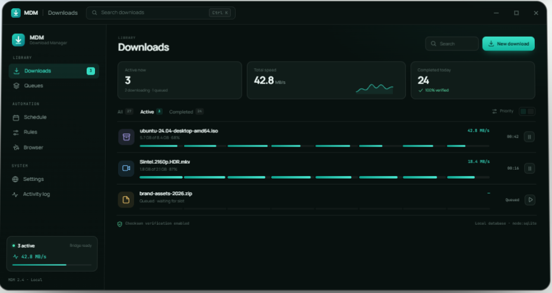

<div align="center">


# MDM — Mohamed Download Manager

**Every download. At full throttle.**

A fast, local-first download manager for Windows 10 and 11 — segmented transfers, browser capture, queues, schedules, site rules, and HLS/DASH/YouTube media downloads in one desktop app.

[](https://mdm-download-manager-mohamed-ashraf.vercel.app/)
[](LICENSE)
[](#requirements)

**[Live download page](https://mdm-download-manager-mohamed-ashraf.vercel.app/)** · [Features](#features) · [Run from source](#run-from-source) · [Build an installer](#build-a-windows-installer)



</div>

> **Independence notice:** MDM is an original, clean-room project. It is not affiliated with, derived from, or endorsed by Internet Download Manager (IDM) or any commercial download manager.

## Download

The latest stable Windows build is available from the official website:

### [Download MDM 2.4 for Windows →](https://mdm-download-manager-mohamed-ashraf.vercel.app/)

| | |
|---|---|
| **Version** | 2.4.0 |
| **Platform** | Windows 10 / 11 (x64) |
| **Installer** | `MDM-Setup-2.4.exe` (215 MB) |
| **SHA-256** | `196A18B7EBDBA437AA16FB97238A45DC4475AFC71D29ECFD384ECB587D2811DE` |
| **Browser add-ons** | Chrome / Edge and Firefox packages are available on the download page. |

Verify the installer before running it:

```powershell
Get-FileHash .\MDM-Setup-2.4.exe -Algorithm SHA256
```

The installer is an NSIS package. It creates Start Menu and desktop shortcuts, allows choosing the install directory, and keeps your database when uninstalling by default.

## What is MDM?

MDM is a Windows desktop download manager built with Electron, React, and TypeScript. It runs entirely on your machine: downloads, queues, rules, settings, and history are stored locally in SQLite. There is no account, cloud sync, or telemetry.

The transfer engine opens up to eight connections per download, resumes interrupted transfers from checkpoints, and adapts when a server rejects range requests. A browser extension hands links from Chrome, Edge, or Firefox to the desktop app over a token-protected loopback bridge. The same app can also download direct HLS VOD and basic static DASH manifests, and uses the bundled `yt-dlp` + FFmpeg tools for supported media pages.

## Features

### Fast, resilient transfers

- Segmented HTTP/HTTPS downloads with up to 8 connections per file.
- Resume, checkpoint recovery, adaptive retry/backoff, redirects, cookies, proxy support, and optional global/per-download speed limits.
- Worker-pool scheduling that reassigns part of a slow segment to an idle connection.
- Automatic single-stream fallback for servers and signed CDN links that do not support range requests.
- Streaming writes and sparse positioned I/O, so multi-GB files are not loaded into memory.
- FTP downloads alongside HTTP/HTTPS.
- Disk-space checks before a transfer starts.
- SHA-256, SHA-1, and MD5 checksum verification.

### Queues, schedules, and rules

- Priority queues with concurrency limits.
- Pause/resume, startup recovery, and optional completion actions.
- Recurring schedules with start/stop windows that can start a queue, stop a queue, resume everything, or pause everything.
- Category rules for video, audio, documents, archives, images, programs, and other files.
- Destination management, duplicate handling (`rename`, `skip`, `overwrite`), default headers, and per-download overrides.
- Site rules with exact or wildcard hosts and file-type filters. The most specific rule wins; actions are `auto`, `ask`, or `ignore`.

### Browser integration

- Chrome/Edge Manifest V3 and Firefox Manifest V3 extensions.
- Context-menu download handoff.
- Optional automatic capture of browser downloads; the browser copy is cancelled only after MDM accepts the transfer.
- Automatic pairing over `http://127.0.0.1:41731` with a generated bearer token.
- Restores and focuses the app, opens Downloads, and scrolls to the new transfer.
- Toast notifications for started, completed, and failed downloads with retry, details, and open actions.
- Quality overlays for YouTube, generic HTML5 video, and players inside cross-origin iframes.
- Network-level media sniffing for HLS/DASH manifests, extensionless signed URLs, and media loaded inside workers.
- **Show video overlays** action in the extension popup to restore hidden controls.

### Media downloads

- YouTube and other `yt-dlp`-supported pages with video quality selection.
- Audio-only M4A, MP3, WebM/Opus, and other native `yt-dlp` audio formats.
- FFmpeg muxing for video + audio.
- Unencrypted HLS VOD: master/media playlists, byte-range segments, relative URLs, and fMP4 initialization sections.
- Basic static DASH manifests with representation selection.
- Encrypted HLS, DRM-protected content, live streams, paywalled, and members-only content are intentionally unsupported. MDM does not bypass DRM or access controls.

### Desktop experience

- Light and dark themes with a native titlebar overlay.
- System tray integration and close-to-tray behavior.
- In-app and native notifications; optionally show native notifications only while the app is in the background.
- Taskbar progress and activity logs.
- Local SQLite database using the built-in `node:sqlite` module (no native database addon).

### Local-first and secure

- Renderer isolation, no Node integration, and a narrow typed preload API.
- The browser bridge listens only on `127.0.0.1`, requires a bearer token, enforces CORS and request-size limits, and rate-limits requests.
- Proxy credentials and the bridge token are encrypted at rest with Electron `safeStorage` / Windows DPAPI.
- TLS validation is on by default; a broken certificate chain can only be allowed per download, never globally.
- Downloaded executables are never launched automatically.
- No telemetry, cloud sync, or account required.
- MDM does not bypass DRM, paywalls, or access controls.

## Requirements

- **Windows 10 or 11 (x64)**
- **Node.js 24+** and **npm 11+** for development
- **Git** and **Git LFS** if you clone the repository (the bundled media tools are stored in LFS; a GitHub ZIP download contains only LFS pointer files for them)

The packaged app bundles `yt-dlp.exe`, `ffmpeg.exe`, and `ffprobe.exe` under `resources/tools`. Development uses the binaries in `tools/`; if they are missing, MDM falls back to `ffmpeg` and `yt-dlp` on `PATH`. The bundled FFmpeg is the [BtbN GPL build](https://github.com/BtbN/FFmpeg-Builds) (GPL v3).

## Run from source

```powershell
git lfs install
git clone <repository-url>
cd idm
git lfs pull
npm install
npm run dev
```

`npm run dev` compiles the main process, starts Vite on port `5173`, watches the main process, and launches Electron.

### Useful commands

| Command | What it does |
|---|---|
| `npm run dev` | Start the app in development mode |
| `npm run verify` | Typecheck + lint + tests + production build |
| `npm test` | Run the Vitest suite |
| `npm run smoke` | Build and run an end-to-end Electron smoke test |
| `npm run smoke:extension` | Load the extension in Chromium and test pairing/overlays |
| `npm run package` | Build the Windows x64 NSIS installer in `release/` |
| `npm run package:portable` | Build a portable Windows executable |
| `npm run smoke:packaged` | Smoke-test the packaged app |
| `npm run build:extension` | Rebuild/sync the Chrome, Edge, and Firefox extension files |
| `npm run icons` | Regenerate icons from `scripts/generate-icons.ps1` |

## Build a Windows installer

```powershell
npm install
npm run verify
npm run package
```

The installer is written to `release/MDM-Setup-2.4.exe`. Builds are not produced by CI because packaging requires Windows and the bundled tools. Attach the installer to a GitHub Release instead of committing it.

## Browser extension

The desktop installer bundles the extension and opens the selected browser's extension page. For development:

```powershell
npm run build:extension
```

**Chrome / Edge**

1. Open `chrome://extensions` or `edge://extensions`.
2. Enable **Developer mode**.
3. Choose **Load unpacked** and select the `extension` folder.
4. Leave **Browser integration** enabled in MDM; pairing happens automatically.

**Firefox**

1. Open `about:debugging#/runtime/this-firefox`.
2. Choose **Load Temporary Add-on**.
3. Select `extension/firefox/manifest.json`.
4. Confirm the bridge URL (`http://127.0.0.1:41731` by default) and let the add-on pair.

Browsers require one manual confirmation for unpacked extensions. MDM's installer copies the unpacked extension path to the clipboard to make this faster. Starting MDM from a browser while the desktop app is completely closed is not supported; start MDM first.

## Site rules

Manage rules under **Rules > Site rules**. Patterns can be exact hosts or wildcard hosts such as `*.example.com`; optional file-type filters limit a rule to extensions such as `zip, pdf, mp4`.

| Action | Behavior |
|---|---|
| `auto` | Queue the download immediately |
| `ask` | Hold the download in MDM until the user starts it |
| `ignore` | Do not capture the download |

The most specific matching pattern wins. A rule can also set a destination directory.

## Media support

| Source | Support |
|---|---|
| HTTP/HTTPS direct files | Segmented, resumable, checksum-capable |
| FTP | Direct file downloads |
| HLS VOD | Unencrypted master/media playlists, byte ranges, fMP4 init sections |
| DASH | Basic static manifests and representation selection |
| YouTube / yt-dlp pages | Video quality selection, audio-only formats, FFmpeg muxing |
| DRM, live streams, paywalled/members-only | Not supported |

DASH audio/video tracks can be downloaded separately, but MDM does not automatically mux them.

## Data location

The SQLite database (`mdm.db`), logs, and settings are stored under:

```text
%APPDATA%\MDM - Mohamed Download Manager
```

On first launch, MDM imports an existing AeroFetch database from `%APPDATA%\AeroFetch` if no MDM database exists.

## Troubleshooting

- **Disk-space error:** MDM refuses to start a transfer that cannot finish. Free enough space for the complete file plus the safety margin, choose another download folder, or retry after cleanup.
- **yt-dlp missing tools:** confirm `tools/ffmpeg.exe`, `tools/ffprobe.exe`, and `tools/yt-dlp.exe` exist during development, or that the packaged app has them under `resources/tools`. Run `tools/ffmpeg.exe -version` in a new terminal to check the binary.
- **Sign-in or bot check:** open the page in your browser while signed in, then retry the download so the extension can pass the page cookies. A site that `yt-dlp` does not support still needs a direct HLS/DASH or MP4/WebM source.
- **Extension not pairing:** make sure MDM is running, **Browser integration** is enabled, port `41731` is free, and the extension has been reloaded.
- **Missing video overlay:** open the extension popup and choose **Show video overlays**, or refresh the page.

## Project layout

```text
src/
  engine/      HTTP/HTTPS/FTP, segmented downloads, HLS/DASH, yt-dlp, checksums, rate limiting
  main/        Electron bootstrap, SQLite database, download manager, bridge, scheduler, IPC
  preload/     Context-isolated renderer API
  renderer/    React UI, state store, pages, components, design system
  shared/      Shared types, defaults, formatting, validation
extension/     Chrome/Edge MV3 extension and shared code
extension/firefox/
scripts/       Icon generation, extension build, smoke tests, cleanup
tests/         Vitest unit and synthetic integration tests
tools/         Bundled yt-dlp, FFmpeg, and FFprobe executables (Git LFS)
assets/        Application, tray, and installer icons
```

## Security notes

- Renderer isolation is enabled; Node integration is disabled; the preload exposes a narrow typed API.
- The bridge binds only to `127.0.0.1`, requires a bearer token, rejects oversized bodies, and applies rate limits. Automatic pairing is limited to browser-extension origins and extension service-worker requests.
- Proxy credentials and the bridge token use Electron `safeStorage` / DPAPI. Secret settings are encrypted at rest.
- TLS certificate validation is enabled by default. The browser download confirmation dialog offers a per-download opt-in for hosts with a broken certificate chain; it is never enabled globally.
- Downloaded executables are never launched automatically.
- MDM does not bypass DRM, paywalls, or access controls.

## Verification

```powershell
npm run verify
npm run smoke
npm run smoke:extension
npm run smoke:packaged   # after npm run package
```

`npm run verify` currently passes typecheck, lint, **102 tests**, and the production build. The Vitest suite covers validation, schedule timing, checksums, rate limiting, sparse writes, segmented HTTP downloads, pause/resume, HLS parsing, YouTube format selection, media-probe caching, database persistence, site-rule resolution, bridge pairing/authentication/rule handling, concurrent capture coalescing, download lifecycle transitions, and actionable notifications. The Electron smoke test starts the app with an isolated data directory, checks every page and the bridge, downloads a fixture through the real IPC/engine stack, and verifies the checksum. The extension smoke test loads the unpacked Manifest V3 extension in Chromium and exercises pairing and the YouTube, generic video, cross-origin iframe, and yt-dlp overlay flows against a mocked bridge.

## Publishing to GitHub

The desktop application is ready to publish as a GitHub repository. GitHub hosts the source and Release assets; the Windows app itself is distributed from the [Vercel download page](https://mdm-download-manager-mohamed-ashraf.vercel.app/). Checked on this checkout: typecheck, lint, 102 tests, production build, Electron smoke test, and packaged-app smoke test all pass.

Two repository-specific details matter:

1. **Use Git LFS.** `tools/ffmpeg.exe` and `tools/ffprobe.exe` are about 161 MB each, above GitHub's 100 MB per-file limit. `.gitattributes` already tracks `tools/*.exe` with LFS. Install and enable it before the first commit:

   ```powershell
   git lfs install
   git init
   git add .
   git commit -m "Initial commit"
   git branch -M main
   git remote add origin https://github.com/<your-user>/<your-repo>.git
   git push -u origin main
   ```

   On a fresh clone, run `git lfs pull` if the tool files are small pointer files. The three bundled tools total about 339 MB, so keep an eye on your Git LFS storage and bandwidth quota.

2. **Publish installers as Releases.** `release/`, `dist/`, and `node_modules/` are ignored. Build with `npm run package` and attach `release/MDM-Setup-2.4.exe` to a GitHub Release. The repository does not currently include a Windows packaging workflow.

The live download page is hosted on Vercel: [mdm-download-manager-mohamed-ashraf.vercel.app](https://mdm-download-manager-mohamed-ashraf.vercel.app/). This repository contains the desktop app source. The optional `website/` marketing-site source referenced by the root `vercel.json` and `.github/workflows/deploy-pages.yml` is not included in this checkout; the desktop build does not depend on it.

### Suggested repository metadata

Use this in the **About** panel when creating the GitHub repository:

| Field | Value |
|---|---|
| **Description** | A fast, local-first download manager for Windows 10/11 with 8-connection segmented transfers, Chrome/Edge/Firefox capture, queues, schedules, site rules, checksums, and HLS/DASH/YouTube downloads. |
| **Homepage** | [mdm-download-manager-mohamed-ashraf.vercel.app](https://mdm-download-manager-mohamed-ashraf.vercel.app/) |
| **Topics** | `download-manager` `electron` `react` `typescript` `windows` `hls` `dash` `yt-dlp` `browser-extension` `local-first` `idm-alternative` |
| **License** | MIT |

The README is the public project description: it covers what MDM is, its features, requirements, how to run it from source, how to build the Windows installer, extension installation, and where users can download the live version.

### Pre-push checklist

- [ ] Run `git lfs install` once per machine and confirm `git lfs track` lists `tools/*.exe`. LFS is required because `ffmpeg.exe` and `ffprobe.exe` exceed GitHub's 100 MB per-file limit.
- [ ] Run `npm run verify` (typecheck, lint, tests, and production build). It passes on this checkout: **102 tests**.
- [ ] Confirm `release/`, `dist/`, and `node_modules/` are not staged.
- [ ] Attach `release/MDM-Setup-2.4.exe` (215 MB, SHA-256 `196A18B7…D2811DE`) to a GitHub Release instead of committing it.
- [ ] Keep the Vercel download page linked. This checkout does not contain the `website/` source needed to rebuild it, so connect Vercel only after restoring that folder.

## License

MDM's source is released under the [MIT License](LICENSE). Bundled third-party tools keep their own licenses:

- **FFmpeg / FFprobe**: GPL v3, BtbN GPL build. Source and build scripts are available in the [BtbN/FFmpeg-Builds](https://github.com/BtbN/FFmpeg-Builds) repository.
- **yt-dlp**: Unlicense.
- Electron, React, and other npm dependencies retain their respective licenses.

Review third-party license obligations before redistributing the packaged application.

## Disclaimer

MDM is provided as-is, without warranty. Download only content you have the right to access. The project does not bypass DRM, paywalls, or access controls, and it is not affiliated with Internet Download Manager or any other commercial product.
